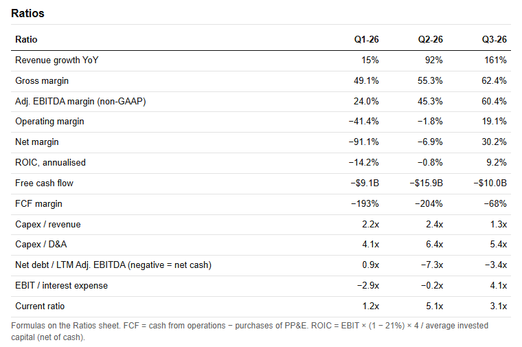
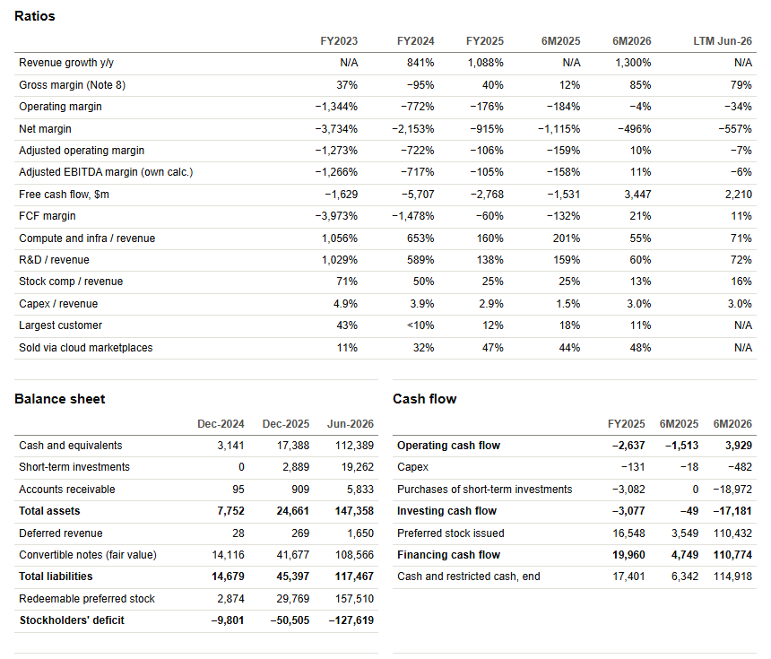

# [Equity Research Lab](https://manucem.github.io/Equity-Research-Lab/)

Company financials rebuilt directly from SEC filings: statements, ratios, operating metrics and page-cited sources.

---

## [SpaceX (SPCX)](https://manucem.github.io/Equity-Research-Lab/SpaceX/)

Q1 2025 to Q3 2026, from the S-1 (filed 20 May 2026) and the Q2 and Q3 2026 results releases.

### Key numbers

| Key number | Value |
|---|---|
| Revenue, Q3 2026 | **$14.6B** (+161% YoY) |
| Adjusted EBITDA, Q3 2026 (non-GAAP) | **$8.8B** (60.4% margin) |
| Net income, Q3 2026 | **$4.4B** (30.2% margin) |
| Capex, first nine months of 2026 | **$48.1B** (1.8x revenue) |
| Starlink consumer subscribers | **13.6M** at 30 Sep 2026 |
| Nameplate compute | **1.7 GW** at 30 Sep 2026 |

### Revenue by segment

| Segment | Q3 2026 | First nine months of 2026 |
|---|---|---|
| SI | $7.6B | $10.9B |
| Connectivity | $5.2B | $12.8B |
| Space | $1.8B | $3.3B |

SI became the largest of the three segments in Q3 2026, up from $0.8B in Q1, driven by solutions and infrastructure revenue.

### Ratios

| Ratio | Q1 2026 | Q2 2026 | Q3 2026 |
|---|---|---|---|
| Gross margin | 49.1% | 55.3% | **62.4%** |
| Operating margin | −41.4% | −1.8% | **19.1%** |
| Free cash flow | −$9.1B | −$15.9B | **−$10.0B** |
| Capex / revenue | 2.2x | 2.4x | **1.3x** |
| Net debt / LTM Adj. EBITDA | 0.9x | −7.3x | **−3.4x** (net cash) |
| Current ratio | 1.2x | 5.1x | **3.1x** |

Capex exceeded revenue in every 2026 quarter, so free cash flow stayed negative even as operating margin turned positive in Q3. The balance sheet at 30 Sep 2026 shows total assets of $254.0B and shareholders' equity of $176.8B. The S-1 copy is truncated, so Q1 2026 is derived as H1 minus Q2.

---

## [Anthropic](https://manucem.github.io/Equity-Research-Lab/Anthropic/)

FY2023 to FY2025, first half of 2025 and 2026, and quarterly figures to Q2 2026, from the Form S-1 filed 26 October 2026.

### Key numbers

| Key number | Value |
|---|---|
| Revenue, last twelve months to Jun 2026 | **$19,708m** |
| Revenue growth, first half 2026 vs first half 2025 | **1,300%** |
| Quarterly revenue | **$376m** in Q1 2025 to **$11,555m** in Q2 2026 |
| Compute and infrastructure cost as % of revenue | **251%** in Q1 2025 down to **48%** in Q2 2026 |
| Cash and short-term investments, Jun 2026 | **$131,651m** |
| Purchase commitments, Jun 2026 | **$265,600m** |

### Revenue mix

| | FY2025 | First half 2026 |
|---|---|---|
| Consumption-based | $3,796m | $13,064m |
| Subscription-based | $789m | $3,222m |
| United States share of revenue | 73% | 72% |
| Sold through cloud marketplaces | 47% | 48% |
| Largest single customer | 12% | 11% |

### Ratios

| Ratio | FY2025 | First half 2025 | First half 2026 |
|---|---|---|---|
| Gross margin | 40% | 12% | **85%** |
| Operating margin | −176% | −184% | **−4%** |
| Adjusted operating margin (non-GAAP) | −106% | −159% | **10%** |
| Free cash flow | −$2,768m | −$1,531m | **+$3,447m** |
| Compute and infrastructure / revenue | 160% | 201% | **55%** |

Operating income turned positive in Q2 2026 (8% margin). The first-half 2026 net loss of $80.7B comes mostly from a $72.4B fair-value change on convertible notes, not from operations. Beyond the $265.6B of purchase commitments, signed leases not yet started total $321.4B.

### Customers

| Metric | Sep 2026 |
|---|---|
| Customers paying $100k+ a year | 11,900 |
| Customers paying $1m+ a year | 1,900 |
| Net revenue retention (approx.) | 900% |
| Top five customers, share of 9M-2026 revenue | 25% |

The S-1 gives no IPO price range.

---

## License

See [LICENSE](LICENSE).
