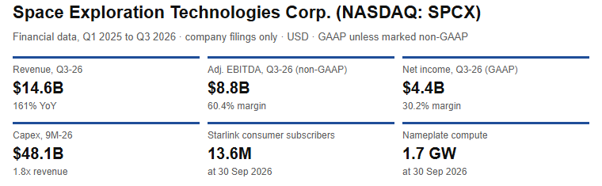
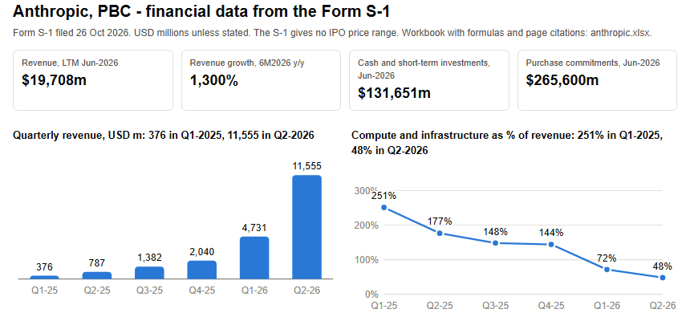

# [Equity Research Lab](https://manucem.github.io/Equity-Research-Lab/)

Company financials rebuilt directly from SEC filings: statements, ratios, operating metrics and page-cited sources.

---

## [SpaceX (SPCX)](https://manucem.github.io/Equity-Research-Lab/SpaceX/)

Q1 2025 to Q3 2026, from the S-1 (filed 20 May 2026) and the Q2 and Q3 2026 results releases.

| Key number | Value |
|---|---|
| Revenue, Q3 2026 | **$14.6B** (+161% YoY) |
| Adjusted EBITDA, Q3 2026 (non-GAAP) | **$8.8B** (60.4% margin) |
| Net income, Q3 2026 | **$4.4B** (30.2% margin) |
| Capex, first nine months of 2026 | **$48.1B** (1.8x revenue) |
| Starlink consumer subscribers | **13.6M** at 30 Sep 2026 |
| Nameplate compute | **1.7 GW** at 30 Sep 2026 |

SI became the largest of the three segments (Space, Connectivity, SI) in Q3 2026, and capex exceeded revenue in every 2026 quarter.

---

## [Anthropic](https://manucem.github.io/Equity-Research-Lab/Anthropic/)

FY2023 to FY2025, first half of 2025 and 2026, and quarterly figures to Q2 2026, from the Form S-1 filed 26 October 2026.

| Key number | Value |
|---|---|
| Revenue, last twelve months to Jun 2026 | **$19,708m** |
| Revenue growth, first half 2026 vs first half 2025 | **1,300%** |
| Quarterly revenue | **$376m** in Q1 2025 to **$11,555m** in Q2 2026 |
| Compute and infrastructure cost as % of revenue | **251%** in Q1 2025 down to **48%** in Q2 2026 |
| Cash and short-term investments, Jun 2026 | **$131,651m** |
| Purchase commitments, Jun 2026 | **$265,600m** |

The S-1 gives no IPO price range.

---

## License

See [LICENSE](LICENSE).
